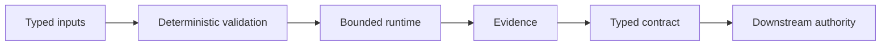
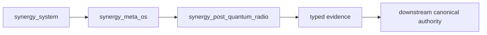

#  SYNERGY Post-Quantum Radio — verified specification dossier

> **Домен:** Network / Radio / Post-Quantum Security  
> **Роль:** спецификация физического UART/LoRa/SDR transport с аутентифицированной постквантовой сессией.  
> **Статус:**  **STUB / specification-only** — на проверенном `main` присутствует только `README.md`; executable runtime, tests и evidence artifacts отсутствуют.  
> **Проверено по фактическому root tree:** 29.09.2026.  
> **Архитектурный родитель:** [`synergy_meta_os`](https://github.com/Shtenco/synergy_meta_os)

## 1.  Проблема и граница проекта

Этот repository резервирует отдельную ответственность внутри SYNERGY: спецификация физического UART/LoRa/SDR transport с аутентифицированной постквантовой сессией.

Ключевой принцип документации здесь — не путать подробно описанную будущую архитектуру с существующей реализацией:

```text
specification != implementation
architecture diagram != runtime integration
roadmap != completed feature
repository name != security/performance proof
```

Пока в `main` нет кода, strongest honest status — **STUB**.

## 2.  Фактическое состояние `main`

```text
synergy_post_quantum_radio/
└── README.md
```

Не обнаружены в root tree:

- `src/` / `runtime/`;
- `tests/`;
- build/dependency manifest;
- CI workflow;
- persisted evidence;
- release/deployment artifact.

Это фиксируется как отрицательный, но полезный факт maturity audit.

## 3.  Целевой design contract

Будущая реализация должна иметь явную цепочку:



Runtime не получает дополнительные полномочия только потому, что находится внутри SYNERGY.

## 4.  Планируемые inputs

- radio frames;
- peer identity/public keys;
- KEM/signature material;
- channel/PHY metadata;
- nonce/session counters;
- payload bytes;

Каждый input должен иметь version/source/provenance там, где это влияет на воспроизводимость или безопасность.

## 5.  Планируемые outputs

- authenticated encrypted frames;
- delivery evidence;
- peer/session identity;
- replay counters;
- latency/loss metrics;
- security failure evidence;

Output становится federation evidence только после schema validation и, при необходимости, cryptographic/content-addressed binding.

## 6.  Authority boundaries

Обязательное системное правило:

```text
component output != downstream authorization
local state      != global/canonical truth
self-reported success != observed evidence
generated artifact != verified artifact
```

Canonical accounting, settlement, risk, governance, identity или deployment authority остаётся у соответствующего domain owner.

## 7.  Threat / failure model

| Failure mode | Promotion requirement |
|---|---|
| replay | mandatory reject/mitigation evidence before promotion |
| downgrade to classical/unauthenticated mode | mandatory reject/mitigation evidence before promotion |
| nonce reuse | mandatory reject/mitigation evidence before promotion |
| RF jamming | mandatory reject/mitigation evidence before promotion |
| packet truncation/reordering | mandatory reject/mitigation evidence before promotion |
| KEM/signature misuse | mandatory reject/mitigation evidence before promotion |
| key persistence leakage | mandatory reject/mitigation evidence before promotion |

Threat model обязан становиться executable через negative tests, а не оставаться только prose.

## 8.  Минимальная test matrix

- [ ] two-node UART loop;
- [ ] LoRa/SDR packet exchange;
- [ ] replay rejection;
- [ ] tamper rejection;
- [ ] key rotation;
- [ ] packet loss/reordering;
- [ ] power-cycle state;
- [ ] PQC known-answer vectors;
- [ ] downgrade prevention;

Дополнительно обязательны malformed-input tests, crash/restart behavior и deterministic fixtures для core logic.

## 9.  Evidence model

Strong evidence package будущего runtime должен связывать:

```text
input/event id
input hash/provenance
software commit
configuration/policy version
result/output
test or execution status
artifact hash
timestamp
limitations
```

Без такого bundle README не должен использовать GREEN/E2E wording.

## 10.  Place in SYNERGY



Стрелка показывает target architecture, **не runtime dependency**.

## 11.  Reproducibility текущего состояния

Сегодня воспроизводить runtime нечего. Проверяемый факт:

```bash
git clone https://github.com/Shtenco/synergy_post_quantum_radio.git
cd synergy_post_quantum_radio
find . -maxdepth 2 -type f
```

Предметный результат текущего `main`: `README.md`.

Когда появится runtime, README обязан заменить этот раздел exact build/test commands и dependency versions.

## 12.  Current vs required repository map

| Surface | Current | Required for CANDIDATE |
|---|---:|---:|
| repository-specific specification |  |  |
| source/runtime |  |  |
| typed schema/contract |  |  |
| unit tests |  |  |
| negative/security tests |  |  |
| CI |  |  |
| evidence artifacts |  |  |
| reproducible build/run |  |  |

## 13.  STUB → CANDIDATE promotion gate

Promotion is allowed only after all of the following exist:

1. executable minimal core;
2. typed input/output schema;
3. deterministic unit tests;
4. at least one negative/failure test per major invariant;
5. pinned dependencies/toolchain;
6. CI command;
7. real repository artifact/evidence;
8. README updated from target tense to implemented tense only for verified pieces.

## 14.  CANDIDATE → E2E_TESTED gate

Requires:

- upstream producer and downstream consumer;
- exact payload binding;
- observed execution;
- persisted evidence;
- verifier;
- no authority bypass;
- reproducible run.

A local unit test is insufficient.

## 15.  Current evidence maturity

```text
Problem/domain definition     
Architecture specification   
Inputs/outputs specification 
Threat/failure model           documented
Executable implementation    
Tests                        
Observed evidence            
E2E                          
Production                   
```

## 16.  Roadmap

1. formalize v1 typed contract;
2. implement smallest executable core;
3. add deterministic fixtures;
4. add failure/security tests;
5. add CI;
6. generate content-addressed evidence;
7. integrate one upstream/downstream pair;
8. run observed federation gate;
9. only then upgrade maturity.

## 17.  Что проект сейчас НЕ утверждает

- что runtime существует;
- что integration уже работает;
- что security/performance claims доказаны;
- что target diagrams соответствуют deployed topology;
- что roadmap items completed;
- что STUB может считаться E2E/production.

## 18.  Federation navigation

- [SYNERGY SYSTEM](https://github.com/Shtenco/synergy_system)
- [Атлас 75 репозиториев](https://github.com/Shtenco/synergy_system/blob/main/docs/SYNERGY_REPOSITORY_ATLAS.md)
- [Documentation quality registry](https://github.com/Shtenco/synergy_system/blob/main/registry/DOCUMENTATION_QUALITY.json)

**Итог:** repository теперь имеет подробный предметный specification dossier, но status сознательно остаётся  STUB до появления кода и evidence.
