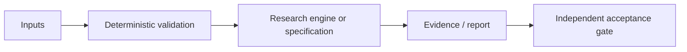

# Post-Quantum Radio: научно-техническое досье V5

**Дата ревизии:** 24.10.2026. **Доказательный статус:** SPECIFICATION ONLY. **Репозиторий:** [Shtenco/synergy_post_quantum_radio](https://github.com/Shtenco/synergy_post_quantum_radio).

> Документационная оценка фактически обнаруженных файлов main. Не является отчётом о свежем запуске CI, независимом benchmark, готовности производства или научным доказательством результата.

## Исследовательская проблема и проектная цель

Спецификация защищённого радиообмена UART/LoRa/SDR.

## Математическое ядро

\[K_{session}=\operatorname{HKDF}(ss,context),\quad nonce\_reuse=0\ \text{(required)}.\]

Математическая запись отделяет модель от операционно подтверждённого результата. Любые заявленные преимущества должны быть перепроверены на сопоставимых baseline и зафиксированных входных данных.

## Архитектурная карта

Это концептуальный поток: стрелки не обозначают уже развернутую связь с другими сервисами.

## Артефакты исходного дерева

- [`README.md`](../README.md)

## Критерии приемки и фальсификация

Планировать KEM-handshake, HKDF, AEAD, anti-replay, nonce uniqueness, loss/reorder/rekey tests.

Обязательные поля для подтверждённого результата: commit SHA, environment, invocation, dataset manifest, raw measurements, baseline, uncertainty, adversarial/negative controls и точная область действия утверждения.

## Ограничения и угрозы

В main нет ни реализации радиопротокола, ни физических испытаний, ни результатов постквантовой сертификации.

Нельзя превращать архитектурную идею, гипотезу, simulated return либо workflow definition в статус DEPLOYED или GREEN без наблюдаемого и проверяемого evidence.

## Следующая итерация

1. Привязать каждый claim к конкретному source/тесту/артефакту.
2. Описать один negative control и минимальный воспроизводимый acceptance-gate.
3. Зафиксировать честный maturity level, а не расширять рекламные формулировки.
4. Сохранять прежние README, историю и исследовательские исходники.

**Эталоны оформления:** [REVERSE-EXP](https://github.com/Shtenco/dlp_solver), [SYNERGY SYSTEM](https://github.com/Shtenco/synergy_system).
